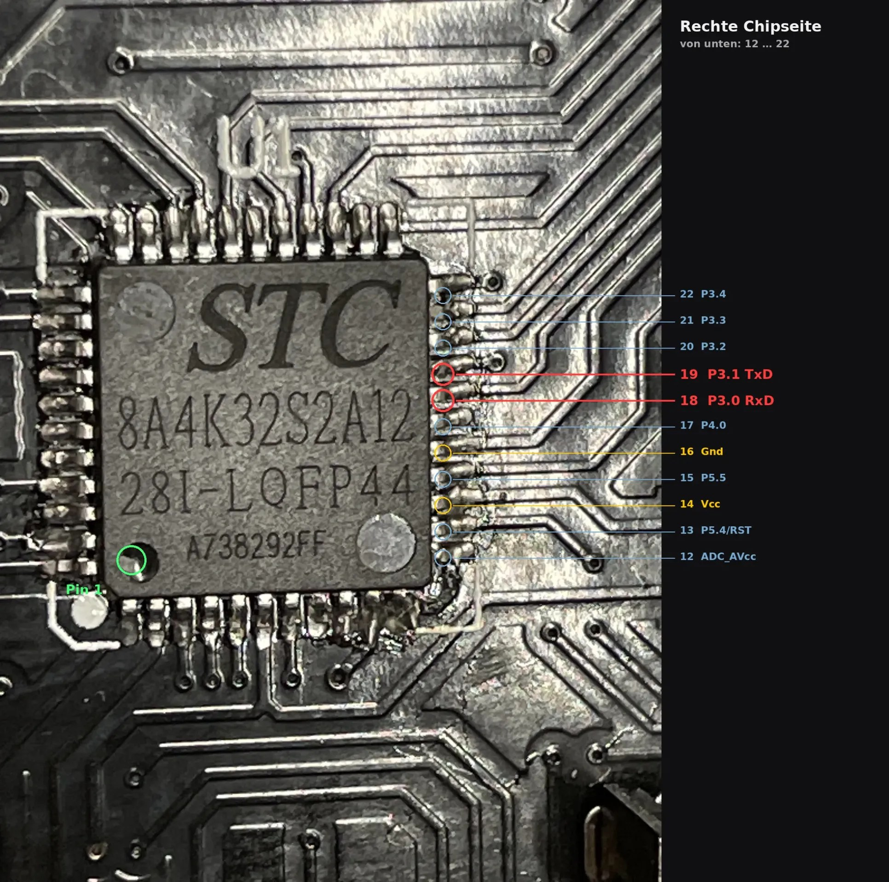
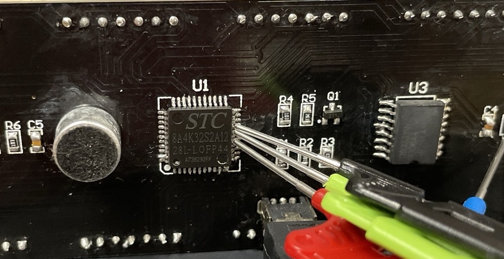

# Control via the serial port

Intended for an ESP (ESPHome or similar) or the PC (`host/live.py`). The clock
accepts commands during operation without the display flickering.

The command letters are mnemonic in German, and the replies are German text
(e.g. `gestellt` = "set", `alarm gesetzt` = "alarm set"); the tables below give
the translation.

## Connection

| Clock | Remote side |
|---|---|
| P3.0 (RxD) | TX – as a precaution via about 1 kΩ (P3.0 is also matrix column 1 and is briefly pulled low) |
| P3.1 (TxD) | RX |
| GND | GND |

921 600 baud, 8N1.

### Pins on the chip

All pin assignments in this repo were determined **in software only**: pins
were driven and read from test firmwares, observed via camera, ADC readings
and I²C acknowledgements. The only measurement with an instrument is the
supply at the light sensor (about 4.9 V).

The UART pins are on the right side of the chip (back of the board, "STC"
lettering readable). Pin 1 is marked at the bottom left; counting runs
counter-clockwise, so the right side goes 12 … 22 from bottom to top.

| Pin | Signal | Connect to |
|---|---|---|
| 14 | Vcc 3.3 V | not needed, the clock has its own supply |
| 16 | GND | GND |
| 18 | P3.0 RxD | TX of the remote side |
| 19 | P3.1 TxD | RX of the remote side |



This is how the adapter is connected in the test: test clamps directly on the
chip legs, no soldering.



**Tested** is a 3.3 V USB serial adapter (FT232R), clamped directly onto the
chip pins, without a resistor: the chip reliably recognises the 3.3 V levels
(50/50 commands on the first attempt). A level shifter towards the clock is
not needed.

**Supply voltages:** the board has a 5 V rail (about 4.9 V, measured with a
multimeter at the light sensor), but the microcontroller runs at 3.3 V from
the AMS1117 regulator (U2). TxD (P3.1) therefore drives 3.3 V levels, which a
3.3 V ESP can take directly. The 1 kΩ resistor towards the clock is only
Claude's precaution and not tested.

## Why a custom protocol

RxD and TxD are also columns of the LED matrix. Lit LEDs feed current into the
receive line; single bytes therefore only arrive by chance. The clock listens
in short **listening pauses** (5 per frame, 80 µs each, all rows off).

## Sending a command line

```
0xFF × 150   command   check character   '\n'
```

1. **Sync:** `0xFF` without gaps, longer than the pause interval (1.2 ms; 150
   bytes at 921 600 baud = 1.6 ms). If three `0xFF` arrive within one pause,
   the clock switches the matrix dark and sends the acknowledgement `!`. Whoever
   reads the acknowledgement may end the sync immediately – then the display is
   dark for a shorter time.
2. **Command:** ASCII or UTF-8 (scrolling text), at most about 200 characters.
3. **Check character:** `0x40 + (sum of all command bytes & 0x3F)`. Lines with a
   wrong check character are discarded – a truncated line must never run as a
   different command.
4. **End of line** `\n`. Afterwards the display continues; the command is
   executed with the display lit.

The display is dark for about 1.5 ms per command. If no characters arrive for
10 ms, the clock gives up the line.

## Reading the reply

The reply (at most 128 bytes) goes out after execution in a short dark moment.
Between `!` and the reply, **garbage bytes** from the display arrive (TxD is
column 2) – they are never printable. To evaluate: after the `!`, take the
first printable line ending in `\r\n`. If nothing comes, repeat the line
(success rate measured at 50/50 on the first attempt, even with all LEDs on).

Example in Python: [`host/live.py`](../host/live.py).

```c
// Sketch for an ESP (Arduino style)
void uhr_befehl(const char *cmd) {
  uint8_t sum = 0;
  for (const char *p = cmd; *p; p++) sum += (uint8_t)*p;
  for (int i = 0; i < 150; i++) Serial.write(0xFF);   // sync
  Serial.print(cmd);
  Serial.write((uint8_t)(0x40 + (sum & 0x3F)));       // check character
  Serial.write('\n');
}
```

## Commands

| Command | Effect | Reply |
|---|---|---|
| `d` | clock registers 0x00–0x06 (sec, min, hour, weekday, day, month, year; BCD) | `25 42 15 07 13 05 31` |
| `sHHMMSS` | set time | `gestellt` (set) |
| `DTTMMJJW` | set date (TT day, MM month, JJ year), W = weekday 1 (Mon) … 7 (Sun) | `datum gestellt` (date set) |
| `T` | temperature of the DS3231 (measured on the chip) | `25.75` |
| `aHHMMx` | alarm at HH:MM, x = 1 on / 0 off | `alarm gesetzt` (alarm set) |
| `lText` | scrolling text (UTF-8, umlauts, °, €, §) | `ok` |
| `CMMSS` | start countdown, `C0000` ends it | `countdown 120` |
| `Vxn` | setting: `w` Anim 0–8, `z` digits 0–5, `d` colon 1–5, `i` info 0–5 (5 = off), `t` theme 1–3, `l` LED 0–3, `h` brightness 0–8, `s` font 1–3 | `ok` |
| `t1` / `t2` | theme 1 or 2 | `ok` |
| `Hn` | fixed brightness 1–8, `H0` automatic | `hell n` (brightness n) |
| `Nn` | choose alarm melody 1–5 | `melodie gewaehlt` (melody chosen) |
| `Mn` | play melody n for about 8 s | `gespielt, spaet 0` (played, late 0) |
| `Un` | alarm puzzle: 0 off, 1 code, 2 arithmetic; `U9` test alarm | `quiz n` |
| `Qn` | night mode 0/1; `Q2` display off immediately until woken | `nacht n` / `aus` (night n / off) |
| `On` | light organ: 1 on, 0 off, 2 trigger a wave | `orgel n` |
| `Y+MMTTJJhhmmfText` | calendar entry (MM/JJ = 00: every month/every year, hhmm = 9999: all day, f = 1 with tone) | `platz n` (slot n) |
| `Y-` / `Ydnnn` | delete all / slot nnn | `kalender leer` / `geloescht` (calendar empty / deleted) |
| `Y?` / `Ylnnn` | count / show slot nnn | `3 belegt, 501 frei` (3 used, 501 free) |
| `v` | light sensor, level, touch, night mode, wake-up reasons, microphone peak | |
| `r` | registers 0x0B, 0x0E, 0x0F | |
| `E` | raw settings (EEPROM sector 0) | |
| `x` | counters: characters, syncs, lines, check errors, dark time slots | |
| `k0`…`k7` / `K` | test pattern (n rows per column on) / back | `ok` |
| `L`text / `S` | only load the text and output the column stream as hex (font check) | |
| `R` | jump into the bootloader (flashing) | |
| `h` | halt: display off, afterwards commands **without** framing directly; `w` continue | |
| `u` | update mode | |

## Flashing via the serial port

`firmware/flash.sh` calls stcgal; its reset script `isp_reset.sh` sends `R` via
this protocol and the clock jumps into the bootloader. The EEPROM is preserved
(`eeprom_erase_enabled=false`).
